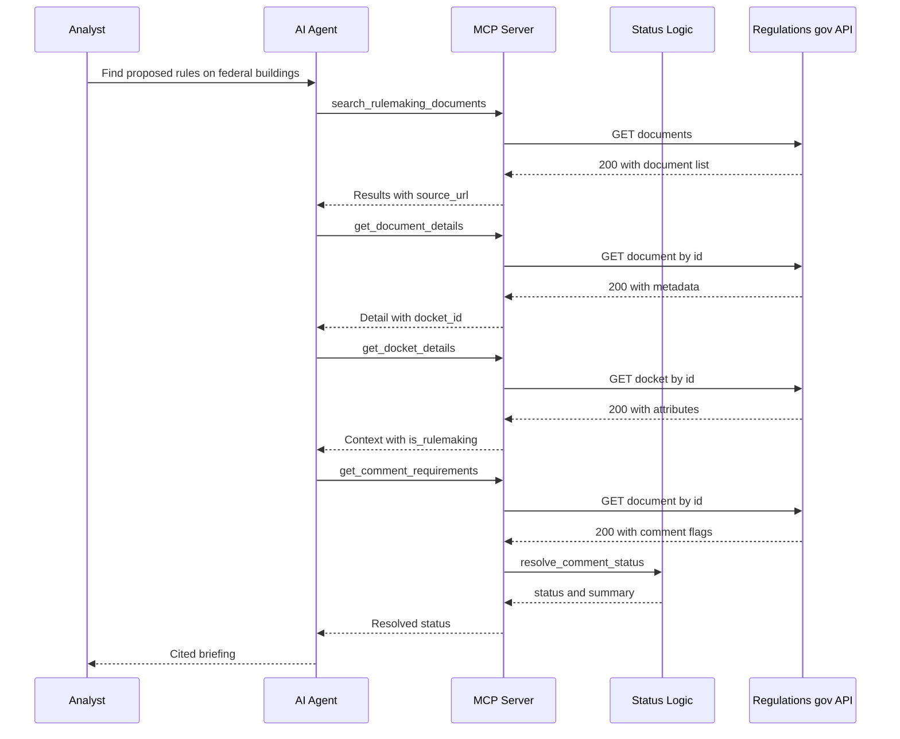

# Security & Governance — Federal Rulemaking Read MCP Server

**Track:** Service "Read" Integration
**Author:** Jorge Nunez
**Last updated:** 2026-09-03

---

## Governance Principle

MCP exposes **capabilities and context**. It does not, and should not,
determine who holds organizational authority. Authorization decisions
remain with the calling system and the human operator.

This server is deliberately **read-only**. It cannot change state in any
government system.

---

## Boundaries

| Boundary | Implementation | Status |
| --- | --- | --- |
| No write operations | Only HTTP GET requests are issued | Implemented |
| No authority inference | Server never evaluates user role or permission | Implemented |
| Fail-closed | Missing API key or failed validation returns an error, never a partial or guessed result | Implemented |
| Bounded surface | Four tools, each with an explicit typed contract | Implemented, 4 of 4 |
| Provenance required | Every result carries a `source_url` to the authoritative record | Implemented |
| Uncertainty stated | Unresolvable data returns an explicit "could not be determined" | Implemented |

---

## Secrets Handling

- API key is read from an environment variable via `.env`
- `.env` is excluded by `.gitignore` and never committed
- `.env.example` provides a placeholder-only template
- The API key is never written to logs, responses, or error messages
- Error messages truncate upstream API responses to 200 characters to
  avoid leaking request context

Verified by scanning all tracked Python, Markdown, JSON, CSV, text, and
INI files for assigned key values. No exposed credentials found.

---

## Data Handling

| Consideration | Position |
| --- | --- |
| Data classification | Public — Regulations.gov is a public federal portal |
| PII | None retrieved; the server requests document and docket metadata only |
| Persistence | None — no caching or storage beyond the request |
| Logging | No secrets, no request bodies, no user identifiers |

---

## Input Validation

All tool inputs are validated by Pydantic models **before** any outbound
API call.

| Rule | Purpose | Status |
| --- | --- | --- |
| `search_term` min length 1 | Prevents empty or wildcard queries | Implemented, test passing |
| `page_size` between 5 and 250 | Enforces the upstream API's documented limits | Implemented, tests passing |
| Document ID pattern, 3+ segments | Rejects malformed identifiers before a network call | Implemented, tests passing |
| Docket ID pattern, 2+ segments | Dockets have one fewer segment than their documents | Implemented, tests passing |

Validation failures return structured errors and consume zero rate limit.
Covered by scenarios S04 and S07.

---

## Failure Behavior

| Condition | Behavior | Status | Verified by |
| --- | --- | --- | --- |
| Missing API key | Fail closed with a clear configuration error | Implemented | Manual |
| Invalid input | Reject before any network call | Implemented | S04, S07, S12 tests |
| Upstream 404 | `DocumentNotFoundError` caught; clear "not found" message | Implemented | S06, S09, S12b |
| Upstream 403 | Client error raised, not empty results | Implemented | S12e, mocked |
| Upstream 429 (rate limit) | Graceful error with retry guidance | Implemented | S12, mocked |
| Upstream 500 | Status code reported; body truncated to 200 characters | Implemented | S12c, mocked |
| Upstream timeout | 10-second timeout on every request | Implemented | S12d |
| Contradictory upstream data | Explicit uncertainty rather than an inferred answer | Implemented | S11 tests |

No condition produces a stack trace to the caller.

**Error messages do not echo upstream response bodies.** The rate limit
message is a fixed string, and other upstream errors truncate the body to
200 characters. Verified by
`test_rate_limit_error_does_not_leak_response_body`, which mocks a 429
whose body contains a credential-like string and asserts it does not appear
in the raised error.

---

## Design Decision: Flag Precedence Over Date Arithmetic

The Regulations.gov API exposes both a `withinCommentPeriod` boolean and
explicit `commentStartDate` and `commentEndDate` fields. These can
disagree.

**Rule applied:** `withinCommentPeriod` takes precedence over locally
computed date comparisons.

**Rationale:** The agency owns the authoritative answer to whether it is
accepting comments. A published end date may lag an extension. Trusting
local arithmetic over the agency's own flag risks telling an analyst a
window is closed when it is not — the more consequential of the two
possible errors.

**Consequence:** When the flag reports open but the end date has passed,
`days_remaining` would compute negative. It is clamped to zero and paired
with the message "closing today or already past the published end date,"
so the output stays honest without implying a deadline that has lapsed.

**Covered by:** `test_within_period_flag_overrides_stale_end_date`

---

## Design Decision: Conditional Submission Link

`get_comment_requirements` returns `comment_url` only when
`accepting_comments` is true. On a closed window it is suppressed to null.

**Rationale:** Offering a submission link for a closed comment period
invites a wasted action. Withholding it is a small safeguard against an
analyst acting on a deadline that has passed.

**Note on the boundary case:** A document with status
`closed_late_comments_accepted` reports `accepting_comments: true` and
therefore does receive a link. Late comments genuinely are accepted, so
suppressing it would prevent a legitimate action. The status enum name and
the summary text both state plainly that submissions fall outside the
official window.

---

## Deferred: Write Path Controls

If a write integration is added later, the following controls are required
**before** any submission capability is enabled:

- A verified approval artifact must accompany every write request
- Idempotency keys to prevent duplicate submissions
- Correlation IDs linking prepare, approve, submit, and receipt
- An auditable receipt returned for every accepted submission
- Fail-closed behavior if approval or monitoring is unavailable

**Current status:** Not implemented. Pending confirmation of a safe
non-production submission environment.

**No API submissions were performed at any point during this project.**

---

## Environment Constraint

Local MCP runtime startup is currently blocked on the development
workstation. The MCP SDK import chain fails when loading a compiled
Windows extension:

```text
ImportError: DLL load failed while importing win32job:
Access is denied.
```

An earlier, similar restriction affecting the `cryptography` package
stopped reproducing later in the same session without configuration
changes, suggesting endpoint-protection scan locks on newly written
compiled binaries.

The analytical logic, API client, data models, and input validation are
decoupled from the MCP SDK and verified working independently. All 30
tests run without importing the transport layer.

See `environment_constraints.md` for full diagnostics.

---

## Read Flow — Sequence Diagram



### Error paths not shown above

| Condition | Behavior |
| --- | --- |
| Input fails Pydantic validation | Structured error before any network call |
| Upstream 404 | `DocumentNotFoundError`; clear "not found" message |
| Upstream 429 | Graceful error with retry guidance |
| Upstream 500 | Status reported, body truncated to 200 characters |
| Upstream timeout | 10-second limit on every request |

Only HTTP GET requests are issued at any step. Comment status resolution
runs in `src/comment_status.py` with no network or MCP dependency.
